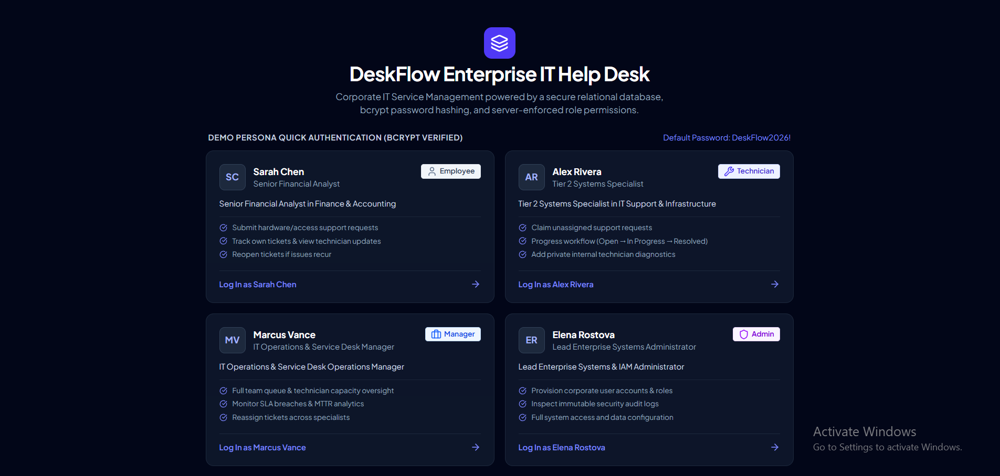
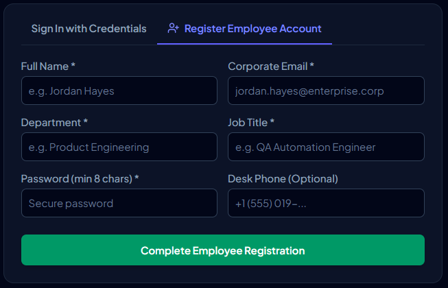
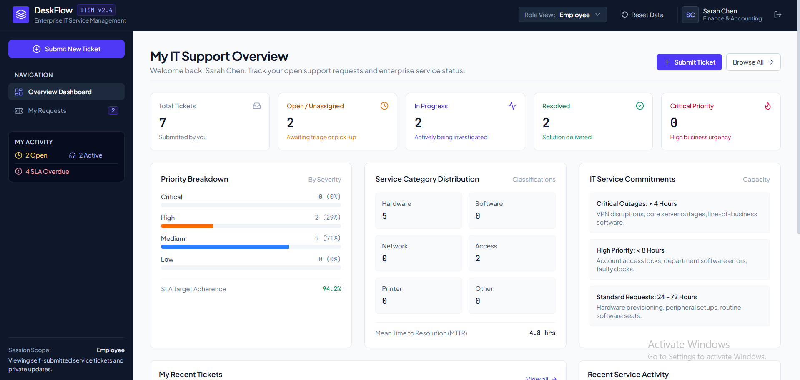
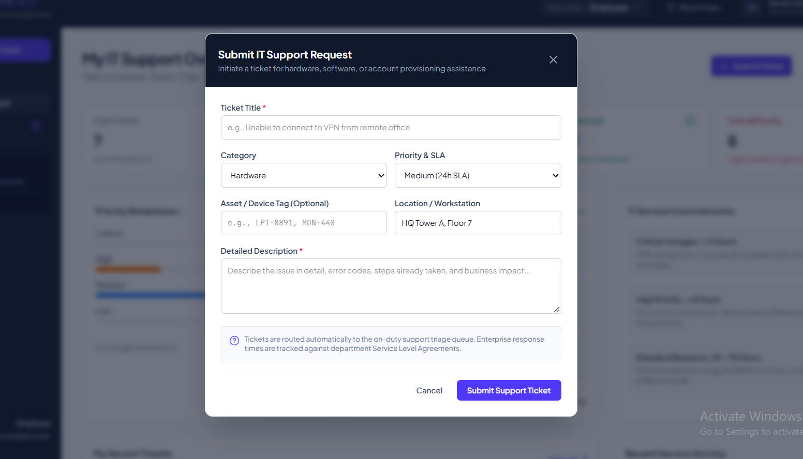
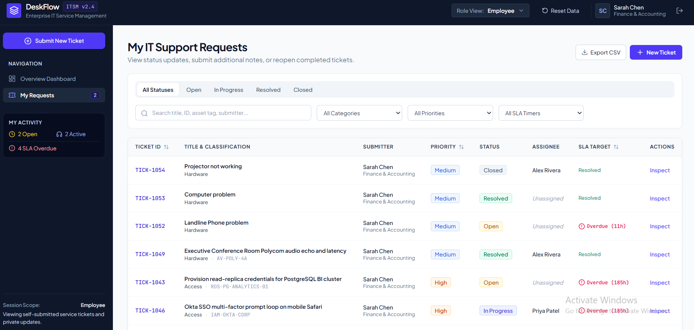
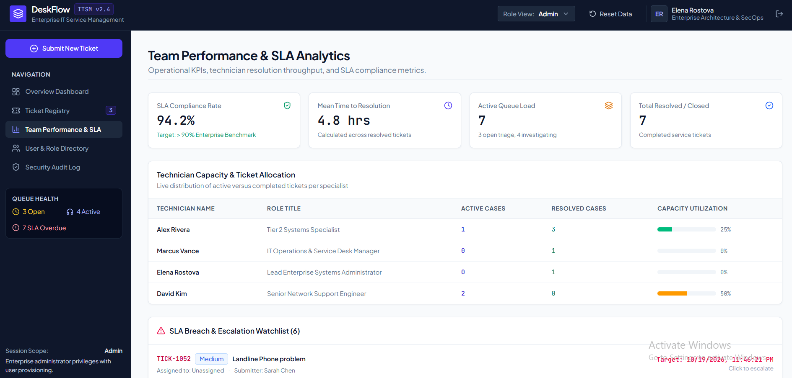

# DeskFlow — Enterprise IT Help Desk & Service Desk

DeskFlow is a full-stack IT help desk application designed to demonstrate how an organisation can manage internal IT support requests, track ticket progress, and coordinate support work across different user roles.

## Overview

Organisations receive IT requests involving hardware, software, network access, printers, and user accounts. Without a central tracking system, requests can be difficult to prioritise, assign, and monitor.

DeskFlow provides a central interface for submitting support tickets, managing their status, recording communication, and reviewing support activity.

## Application Screenshots

### Quick Authentication


### Registration form


### Dashboard


### Ticket submission


### My Ticket list


### Team performance


## Features

- **Enterprise Role-Based Access Control (RBAC):**
  - **Employee:** Submit support requests, monitor ticket progress, post updates, and reopen resolved tickets if issues recur. Strict data isolation prevents seeing other employees' tickets. Internal IT technician notes are automatically redacted.
  - **Technician:** Triage service desk queue, claim unassigned requests, update lifecycle status, and author private internal diagnostic notes.
  - **IT Manager:** Full visibility into team workload, technician capacity, SLA compliance, and MTTR performance analytics.
  - **Administrator:** Provision corporate users, manage role assignments, activate/deactivate accounts, and inspect security audit logs.
- **Ticket Lifecycle Workflow:**
  - Enforced states: `Open` &rarr; `In Progress` &rarr; `Resolved` &rarr; `Closed`.
  - Mandatory technical resolution notes and root-cause taxonomy upon resolution.
  - Documented rationale required to reopen tickets.
- **Operations Dashboard & Analytics:**
  - Live KPIs for open, in-progress, resolved, critical priority, and SLA overdue tickets.
  - Priority breakdown and category distribution (Hardware, Software, Network, Access, Printer, Other).
  - Technician capacity and active caseload gauges.
  - Chronological service activity stream.
- **Advanced Filtering & Reporting:**
  - Real-time text search across ticket IDs, titles, descriptions, and hardware asset tags.
  - Segmented status tabs, priority filters, SLA timers, and assignee selectors.
  - One-click CSV export for offline operational audits.
- **Secure Authentication & Sessions:**
  - Passwords hashed using **Bcrypt** (10 salt rounds).
  - 64-character cryptographically random session tokens stored in Supabase with 24-hour expiration.
  - Client identity verified strictly via Bearer session tokens (no client-supplied ID trusting).

---

## Technology Stack

- **Frontend:** React 19, TypeScript, Tailwind CSS v4, Lucide React icons
- **Backend:** Express 4.x, TypeScript (running via `tsx server.ts`)
- **Database:** Supabase PostgreSQL with relational foreign keys and indexes
- **Bundler:** Vite 8 middleware integration

---

## Getting Started

### 1. Clone the repository
```bash
git clone https://github.com/<your-username>/deskflow.git
cd deskflow
```

### 2. Install dependencies
```bash
npm install
```

### 3. Configure environment variables
Create a `.env` file in the root directory by copying the example template:
```bash
cp .env.example .env
```

Populate `.env` with your Supabase project credentials:
```bash
SUPABASE_URL="https://your-project-id.supabase.co"
SUPABASE_ANON_KEY="your-supabase-anon-key"
SUPABASE_SERVICE_ROLE_KEY="your-supabase-service-role-key"
```

### 4. Database Setup (Supabase)
In your Supabase project's **SQL Editor**, run the schema creation queries for:
- `users`
- `sessions`
- `tickets`
- `comments`
- `ticket_history`
- `audit_logs`

*(The application will automatically seed initial demo data upon first launch if the `tickets` table is empty).*

### 5. Start the development server
```bash
npm run dev
```

Open [http://localhost:3000](http://localhost:3000) in your browser.

---

## Pre-seeded Demo Personas

All pre-configured demo accounts can be authenticated with the default password: **`DeskFlow2026!`**

| Persona | Role | Department | Email |
|---|---|---|---|
| **Sarah Chen** | Employee | Finance & Accounting | `sarah.chen@enterprise.corp` |
| **Alex Rivera** | Technician | IT Infrastructure & Support | `alex.rivera@enterprise.corp` |
| **Marcus Vance** | IT Manager | IT Service Management | `marcus.vance@enterprise.corp` |
| **Elena Rostova** | Administrator | Enterprise Architecture & SecOps | `elena.rostova@enterprise.corp` |

---

## License

MIT
